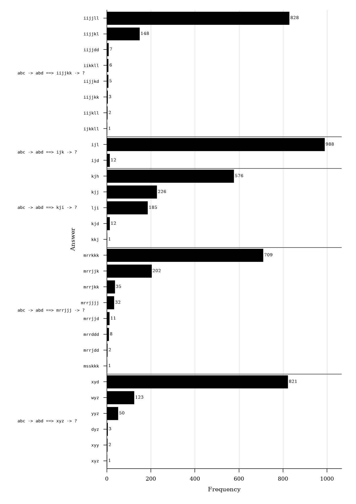
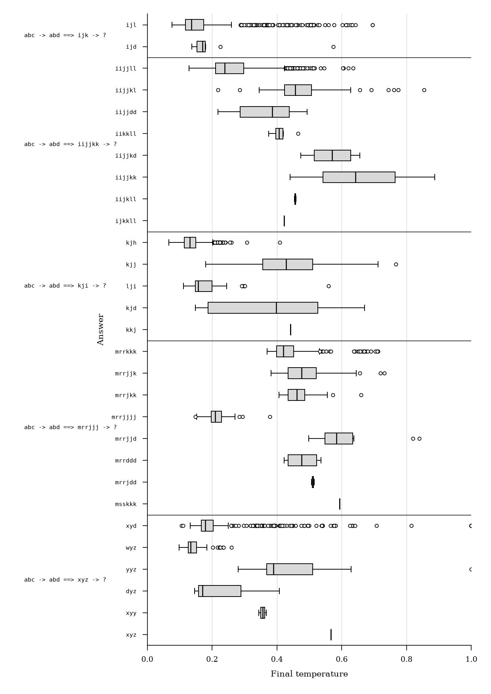
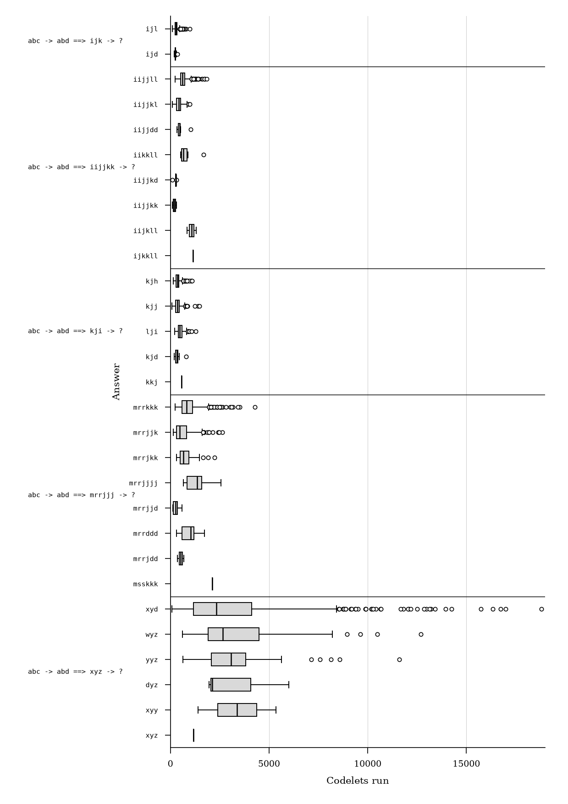
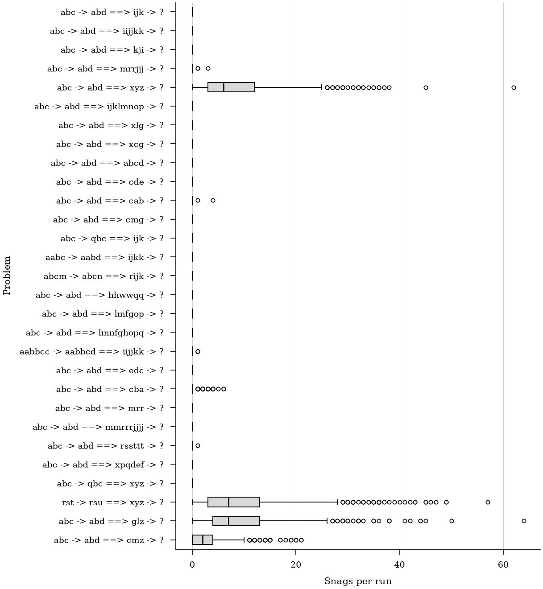
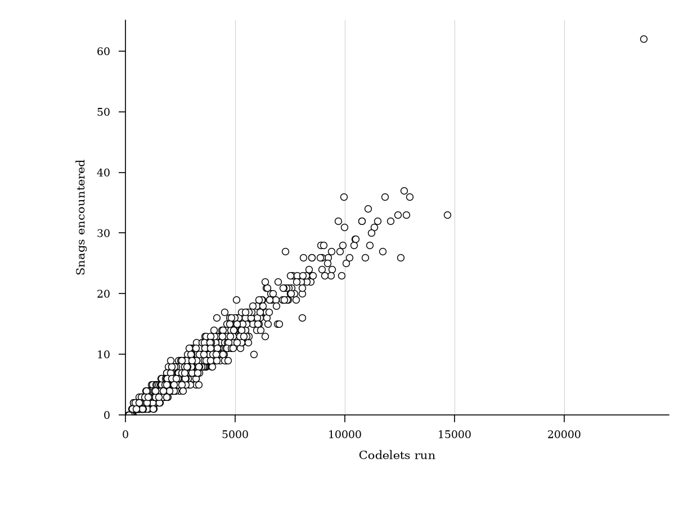

# \[Re\] Copycat: a Replication of the Classic Model of Analogy-Making
George Alexander Wright
2026-11-11

# Introduction

This paper describes a replication study of Copycat, a computer model of
analogy-making that solves string analogies of the form “if *abc* is
transformed to *abd*, what is *ijk* transformed to?” (Mitchell 1993).
The primary target for replication is the experimental evaluation
reported in Chapters 4 and 5 of Mitchell (Mitchell 1993), comprising
1,000 runs on each of a fixed benchmark of five target problems and 24
variants problems.

Copycat is based on research by Douglas Hofstadter and the Fluid
Analogies Research Group (FARG) into the flexible use of concepts by
humans when they perceive and think about the world (Hofstadter and
Fluid Analogies Research Group 1995). Copycat and related models
represent an approach to artificial intelligence at the intersection of
symbolic and statistical approaches and fit into a *middle-out* approach
to AI advocated for by Wang and Thórisson (Wang and Thórisson 2025).

While the original implementation of Copycat is available online,[^1] it
is written in a dialect of Common Lisp that is not compatible with the
standard implementations available today and makes use of now
non-existent dependencies. This makes the historically important result
difficult to replicate or build upon.

The Python re-implementation of Copycat described herein is the first
step in a project that aims to construct a general library for building
FARG-type models so that they can continue to be experimented on and
better understood. Copycat makes a good starting point for this research
program as it is one of the best-documented models and it informed
subsequent models produced by FARG and others.

Across the fixed 29-problem benchmark, the Python re-implementation
produces answer frequencies and mean temperatures similar to those
reported for the original Lisp Copycat. This close re-implementation
makes possible further analysis of the Copycat architecture, for
example: experiments to show how changing the precision of temperature
and other values impacts on the efficiency of Copycat’s search for
solutions; and a statistical and critical analysis of Copycat’s
encounters with and approach to handling *snags* when solving certain
problems.

# Background

Copycat is a workspace-based architecture in which a problem is
represented by graph-like data structures. These are operated on by a
series of micro-agents called *codelets*. Codelets make incremental
changes to the workspace such as by proposing, building, or destroying
new connections, groupings, and rules that contribute towards a
solution. Once a codelet has run, it can spawn another follow-up codelet
which is placed on a *coderack* (a stochastic priority queue). The
program also contains a symbolic network of spreading activation called
a *slipnet* whose nodes receive activation from the workspace and once
fully active can post codelets to the coderack. Events such as codelet
selection happen with a degree of randomness determined by the program’s
changing *temperature*, a measure of the quality of structures in the
workspace. The program lacks a central orchestrator: choices are mostly
made as a result of the interactions of many small components.

## FARG models and software

FARG models typically centre around a set of components similar to the
workspace, slipnet, coderack, and temperature. Each model works in a
particular micro-domain designed to test a particular type of perception
or reasoning.

Copycat (Mitchell 1993) and Metacat (Marshall 1999) make analogies
between transformations of letter strings; Tabletop (French 1995) also
makes analogies, but between objects pointed to on a table; Capyblanca
(Linhares 2014) makes analogies in chess; Letter-spirit (Hofstadter and
McGraw 1995) completes the design of fonts once given some examples (a
kind of visual analogy-making); Jumbo (Hofstadter 1995) and Numbo
(Defays 1995) build hierarchical structures of letters and numbers
respectively in order to play an anagram or maths game; Seqsee (Mahabal
2010) finds patterns in sequences of numbers in order to predict the
next element; Musicat (Nichols 2012) finds patterns in sequences of
musical notes.

The original code for many (but not all) of these models is available
online.[^2] The models were developed over an extended period of time
using different programming languages, some of which are difficult to
run on modern computers.

## The original Copycat

The original implementation of Copycat[^3] consists of nearly 12,000
lines of Common Lisp. It does not run unmodified in contemporary
environments due to its dependence on obsolete software and
dependencies. The code includes the implementations of the various
components described in
<a href="#sec-background" class="quarto-xref">Section 2</a>, written in
a mixed object-oriented/procedural style. For the most part, it matches
closely with the description of the model by Mitchell (Mitchell 1993).

But it also includes important functionality that Mitchell does not
describe in detail, including: the steps involved in using a
transformation rule to generate the answer string; how the program
recognizes when a string cannot be built based on the rule (this is
called hitting a *snag*); and how the program handles snags. Snag
handling is discussed in more detail in
<a href="#sec-snags" class="quarto-xref">Section 6.1</a>.

The code contains various parameters that can be altered such as the
frequency with which slipnet nodes’ activations should be updated;
weights used in functions for using temperature to alter probability
distributions; the configuration of the slipnet with nodes representing
concepts relevant to the domain (e.g. A, B, C, LETTER-CATEGORY, LEFT,
LEFTMOST, OPPOSITE); and the weights of slipnet connections.

The original implementation’s code is also interspersed with calls to a
graphical user interface used to display the workspace structures and
slipnet activations.

Readers should consult Mitchell (Mitchell 1993) or Hofstadter
(Hofstadter and Fluid Analogies Research Group 1995) for a full
description of the architecture. Mitchell’s book describing the
architecture provides a large amount of implementation detail.

## Other implementations and generalizations

As one of the better known FARG models, Copycat has been re-implemented
before with implementations made available online, including in Java[^4]
and in Python[^5], but none of these appear to be accompanied by a full
replication study including statistical comparison.

Metacat, which is an extension of Copycat implemented in Scheme,[^6]
also has much in common with the original Copycat implementation. Apart
from Metacat, none of the re-implementations appear to have been made
with a view to extending Copycat or to building a more general model.
Other projects exist online which have sought to build a more general
FARG model, such as Paradex[^7] and PySeqsee,[^8] but they no longer
seem to be active.

# Methods

The benchmark comprises the five target problems and 24 variations
reported by Mitchell (Mitchell 1993). Published results were transcribed
from chart labels in chapters 4 and 5 of Mitchell (Mitchell 1993). These
include: answer frequencies; mean final temperature per unique problem
answer (with standard errors); and mean codelet counts per problem (with
standard errors).

The experiments used the Python re-implementation of Copycat (version
0.1.1) available in the Cattykit repository (version 0.1.3) and were run
with Python 3.13. Copycat was run 1,000 times on every problem, with the
model instantiated anew using seeds 0–999; all runs continued until an
answer was produced and no experimental runs were excluded.[^9]

There are three dimensions along which successful replication of the
original study can be judged: similarity of answer distributions
produced by reference and re-implementation; similarity of final
temperatures for the same answers; and similarity of codelets run per
problem.

Answer distributions are compared using total variation (TV) distance.
Each answer distribution is represented as a probability vector, with
one component for each answer observed in either distribution. TV
distance is half the sum of the absolute differences between
corresponding answer probabilities. A distance of zero indicates
identical distributions; values closer to 1 indicate greater
discrepancy. Subtracting the TV distance from 1 gives the empirical
distributional overlap of the two implementations.

The TV distances can be compared to a 95% reference range of distances
that would be expected from running the original Copycat experiments a
second time and comparing their outputs with the reported results. For
each problem, the reference answer frequencies are treated as a fixed
probability distribution and a simulated sample of 1,000 answers can be
drawn from that distribution to produce a new set of answer frequencies.
The TV distance of sample and original reported distribution is
calculated and a 95% reference range is built by taking the 2.5th and
97.5th percentiles from the distance calculations across 10,000
simulations.

Temperature error is calculated only for answers observed in both
implementations and summarized both equally across answers and weighted
by the published answer frequencies (to reduce the influence of
outliers). For an unweighted mean difference, the standardized
discrepancy is calculated using the square root of the sum of the two
squared standard errors; RMS z is the root mean square of these
discrepancies across comparisons, excluding answers observed fewer than
twice in either implementation, for which the standard error cannot be
estimated. For the purpose of this study, the original temperatures are
converted to 2 decimal place floats between 0 and 1 so that they have
the same representation as in the re-implementation.

Codelet count error is calculated per problem as the original study only
reports mean codelet counts per problem. The relative error is used for
codelet counts as codelet counts have no upper bound (whereas
temperature lies on a fixed scale). It is calculated as the absolute
difference between means divided by the published mean.

## Obstacles encountered

The re-implementation of the Copycat model was relatively free of
obstacles as the original code is well-documented by both inline
comments and the aforementioned publications. Furthermore it was
possible during development to use LLM-based coding agents to perform
code reviews by asking them to compare the two implementations. This
sped up the search for discrepancies towards the end of development.

There were more obstacles when it came to a full replication of
Mitchell’s experiments on the model. Mitchell (Mitchell 1993) does not
describe how 1,000 runs were performed, including whether or not random
seeds were used, if so how they were chosen, and how the program was
reset between runs (i.e. was it given a new seed or were components
deleted or set back to their starting state?). The selection method of
random seeds could affect the resulting distribution of behaviours.

Furthermore, Mitchell does not provide raw results of experiments: final
temperatures and run lengths are reported as summary statistics (mean
and standard error). This prevents a full comparison of final
temperature and run length distributions. The statistics are also
rounded to one decimal place, thus limiting the precision of
cross-implementation comparison of the means and standard errors.

## Criteria for successful replication

Because Copycat is stochastic and because of the aforementioned
obstacles, it is unreasonable to expect a re-implementation to perfectly
replicate the results described by Mitchell. There are therefore no hard
pass/fail thresholds are used in this study. But a successful
replication ought to have a high overlap of answer distributions for
each of the 29 problems with TV distance between re-implementation and
reference answers also falling within the 95% reference range in most
cases. Mean absolute error of mean final temperature (weighted by answer
frequency) should also be low. Higher errors for answers with low
frequencies can be tolerated since the same answer can be output
alongside a range of temperature values. Mean relative error of mean
codelets run should also be low, but similar run length is a less direct
measure of behavioural agreement since it is path dependent and could be
affected by the slight variations in answers and temperatures.

# The re-implementation of Copycat

The Python re-implementation was developed using the original Lisp
source code and Mitchell’s (Mitchell 1993) published descriptions as
references. The main differences introduced in the re-implementation
include:

- A bug fix relating to removal of excess codelets from the coderack. In
  Copycat, the coderack cannot hold more than 100 codelets. When the
  maximum is reached, codelets should be removed probabilistically,
  according to age and urgency. The original implementation removes
  codelets without removing their corresponding removal probability and
  codelets therefore lose alignment with their probability of being
  removed. In practice a sensitivity comparison shows that this makes
  little difference to overall behaviour, likely because relatively few
  codelets are removed at a time[^10].
- Use of floating point numbers instead of integers between 0 and 100
  for values such as temperature, slipnode activations, and workspace
  structure strengths. (In the evaluation described in
  <a href="#sec-evaluation" class="quarto-xref">Section 5</a>, a
  quantization patch rounds numbers to two decimal places in order to
  more closely mirror the original Copycat source code’s use of integers
  between 0 and 100. A further experiment in
  <a href="#sec-quantization" class="quarto-xref">Section 6.2</a>
  explores the effect of removing this patch);
- Use of a matrix to define connections in the slipnet so that spreading
  activation could in future benefit from a parallelized GPU back-end.

# Evaluation

Outputs collected from runs of the re-implementation are similar to
those reported for the original Lisp implementation. Comparison
statistics shown in
<a href="#tbl-comparison-statistics" class="quarto-xref">Table 1</a>
quantify how closely the re-implementation replicates answer
distributions, temperatures, and mean run lengths.

Figure 1: Answer frequency distributions. Only results for the five
target problems are shown for the sake of readability.

Figure 2: Final temperature distribution. Only results for the five
target problems are shown for the sake of readability.

Figure 3: Codelets run distributions. Only results for the five target
problems are shown for the sake of readability.

Table 1: Comparison statistics for the baseline replication across 29
problems.

| Measure                                    | Value |
|:-------------------------------------------|------:|
| Mean answer TV distance                    | 0.021 |
| Max answer TV distance                     | 0.055 |
| Mean runs with reproduction-only answers   | 1.207 |
| Temperature unweighted mean absolute error | 0.037 |
| Temperature weighted mean absolute error   | 0.005 |
| Temperature max absolute error             | 0.460 |
| Temperature RMS z                          | 1.194 |
| Temperature max \|z\|                      | 4.992 |
| Codelets-run mean relative error           | 0.033 |
| Codelets-run max relative error            | 0.144 |
| Codelets-run RMS z                         | 1.693 |

## Answer distributions

The re-implementation of Copycat outputs mostly the same answers with
similar frequency to the original implementation. The modal answer is
identical for 28 of the 29 problems. For one problem, the two nearly
tied most frequent answers are reversed[^11]. All answers occurring in
at least 1% of historical runs also occur in the replication study, and
all answers occurring in at least 1% of replication runs are also
reported in the historical study.

The average TV distance across all problems is 0.021, indicating a mean
empirical overlap of 97.9%. Overlap is (slightly) below 95% for just one
of the 29 problems tested. 24 out of the 29 problems resulted in an
answer distribution that has a TV distance within their 95% Monte Carlo
reference range. 5 problems marginally exceeded their 95% reference
range, but those ranges do not account for uncertainty in the published
frequencies. The re-implementation therefore closely replicates the
published answer distributions.

## Final temperatures

Mean final temperatures for corresponding answers are also generally
similar between reference and re-implementation. Across the 29 problems,
the mean absolute error is 0.5% when weighted by answer frequency and
3.7% when answers within each problem are given equal weight. The higher
unweighted error reflects, in part, larger discrepancies for many
infrequent answers. The largest difference is 46 percentage points for
an answer observed only once in each implementation; such a mean is
sensitive to the outcome of a single run.

Excluding answers observed only once in either implementation, for which
a standard error cannot be estimated, the root mean square of the
standardized discrepancy is 1.194. The discrepancies are therefore, in
aggregate, approximately the same order of magnitude as the combined
reported sampling errors.

## Run lengths

Mean run lengths are similar between the two implementations across the
benchmark. The mean relative error in codelets run is 3.3%. Agreement
varied by problem: the largest relative error is 14.4%, but only one
other problem has an error above 10%.

Run length is a less direct measure of behavioural agreement than the
answers produced. It depends on the sequence of structures built and
codelets selected during a run, so implementations may reach similar
answers with different amounts of search. The root mean square of the
standardized discrepancy of mean run length is 1.693, which indicates
slightly greater discrepancies than can be expected from sampling alone,
but since this incorporates all 1,000 runs per problem, outliers are not
excluded.

# Further analysis of the re-implementation

Having established that the Python re-implementation closely matches the
original implementation of Copycat, it is possible to perform more novel
analysis of Copycat. This section explores Copycat’s snag handling
procedure and the effect of replacing temperature, activations, and
other values with full precision 64-bit floating point numbers.

## Snags

Figure 4: Snag count distributions across the 29 problems.

Figure 5: Codelets run vs snags encountered for runs on problem abc -\>
abd ==\> xyz with answer xyd

Sometimes when solving a problem, Copycat can encounter a *snag* (also
referred to by Mitchell (Mitchell 1993) as an *impasse*). This happens
when a rule is built that cannot be applied to the letters in the target
string. For example, when producing a solution for the problem
`abc -> abd ==> xyz`, Copycat might construct a rule to replace the
letter `z` with its successor. But since `z` has no successor, Copycat
cannot apply the rule.

In descriptions of the Copycat architecture, Mitchell does not provide
great detail of how snags are recognized and handled or how often they
occur for each problem (other than that they occur on average 9 times
per run for the `xyz` problem (Mitchell 1993, 133)). The
re-implementation allows further statistical analysis in this direction
and shows (see
<a href="#fig-all-problems-snag-count" class="quarto-xref">Figure 4</a>)
no snags were encountered across 1,000 runs for most of the problems and
that observed snags were concentrated in problems where solutions can
relate to the ends of the alphabet or for groups with different numbers
of letters.

Snag handling occurs during answer construction, which proceeds
deterministically once a rule-translator codelet has built a rule for
producing an answer. When a snag is hit, Copycat clamps its temperature
to maximum, marks structures in the workspace as *snag structures*,
deletes any proposed structures, deletes the translated rule, clamps the
activation of descriptors of the object, and enters a *snag state*. It
then periodically decides probabilistically (every 15 codelets) whether
or not to leave a snag state according to the proportion of newly built
structures that are equivalent to the structures present when the snag
state was entered. Fewer equivalent structures increase the likelihood
that the *snag state* will be left and the program’s temperature will be
allowed to fall.

Handling snags allows Copycat to continue trying to find a solution. As
noted by Mitchell (Mitchell 1993, 133), this can often result in the
same problematic structures being retried, something which humans can
also be prone to when they try to solve hard problems. This can be seen
in <a href="#fig-target-problems-codelets-run-by-solution"
class="quarto-xref">Figure 3</a>, where the relatively mundane answer to
`abc -> abd ==> xyz -> xyd` has a very wide distribution of run lengths.
This is largely associated with repeated snags occurring when the
program tries to find the successor to `z`.
<a href="#fig-problem-5-xyd-codelets-vs-snags"
class="quarto-xref">Figure 5</a> shows a strong positive association
between snags encountered and codelets run for the 835 runs producing
this answer (Pearson’s *r* = 0.980). Across the 9 recorded problems
which encountered snags, linear regression estimates an association of
between 349 and 1,341 additional codelets per additional snag. This
association is partly mechanical: a snag forces more codelets to run so
that it can be fixed and more codelets running on a hard problem
increases opportunities for snags.

Snag handling is deterministic, requires a more global view of the
workspace, and is tailored to a specific subset of Copycat’s problems.
This deviates from the broader style of the architecture in which
responsibility for observing and editing the workspace is usually
delegated to codelets stochastically selected from the coderack. It
might therefore be judged to be incompatible with the broader FARG
approach to AI and it has indeed been further addressed in the model
Metacat, an extension of Copycat which Marshall (Marshall 1999)
describes as having *self-watching* capabilities. This will be the
subject of a future replication study.

## Comparison of numeric quantization methods

Table 2: Comparison of two decimal place quantization and full precision
variants across 29 problems.

| Measure | Two-decimal quantization | Full precision |
|:---|---:|---:|
| Mean answer TV distance | 0.021 | 0.021 |
| Max answer TV distance | 0.055 | 0.058 |
| Mean runs with reproduction-only answers | 1.207 | 1.034 |
| Temperature unweighted mean absolute error | 0.037 | 0.027 |
| Temperature weighted mean absolute error | 0.005 | 0.005 |
| Temperature max absolute error | 0.460 | 0.259 |
| Temperature RMS z | 1.194 | 1.567 |
| Temperature max \|z\| | 4.992 | 12.180 |
| Codelets-run mean relative error | 0.033 | 0.071 |
| Codelets-run max relative error | 0.144 | 0.418 |
| Codelets-run RMS z | 1.693 | 3.857 |
| Mean snag count on snaggable problems | 3.079 | 3.086 |
| Max snag count | 64 | 72 |

As described above, this re-implementation of Copycat makes use of
floating point numbers for values such as slipnode activation, but in
the above experiments, a patch was used which rounded floating point
numbers to two decimal places so as to better match the original Copycat
implementation. Removal of the patch so that floating point numbers use
64-bit precision results in similar answer distributions and
temperatures for each answer. But it results on average in much longer
run lengths.

<a href="#tbl-quantization-comparison" class="quarto-xref">Table 2</a>
shows that both variants have high agreement with the published answer
frequencies and temperature means. Their answer distributions have the
same TV distance from the reported results and their average temperature
errors are very low. Only a slight increase in the overall discrepancy
in temperature scores is observed for the 64-bit version.

The main difference between the two is evident in search effort
(measured in codelets executed). The quantization patch is implemented
with a rounding step whenever any floating point number is assigned to
an object’s attribute (e.g. the temperature, slipnode activations, and
workspace structure strength values). It also rounds NumPy state,
probability calculations, temperature-adjusted values, and
weighted-selection weights. There can therefore be no advantage to
quantization in terms of memory usage (the same underlying data type is
used) or to wall-clock run-time per codelet (the rounding steps add
extra operations). But removing the two decimal place quantization patch
more than doubles the mean relative error against the published codelet
counts and increases the maximum relative error from 14.4% to 41.8%.
Using higher precision for temperature, activations, strength values,
and other numbers therefore has little effect on answers and
temperatures but is associated with a substantial increase in the number
of steps taken to find the same answers. The aggregate snag rate is
nearly unchanged. Each program version observes at least one snag in a
set of 9 different problems, the union of which contains 10 unique
problems. Across these, six have lower mean snag counts with the
quantization patch, while four have higher counts. The increase in
codelet counts is therefore not explained by an increase in snags.

Rounding values in the program introduces slight changes at which values
cross certain thresholds. Many of these values are used to calculate
codelet urgencies which determine the urgency bin that each codelet is
placed in. Successive rounding up and down might be increasing the
separation between beneficial and harmful structures, slipnodes, and
codelets and therefore reducing time spent exploring pathways that do
not lead to a solution.

# Conclusion

This paper introduces a Python re-implementation of the analogy-making
model Copycat. On the 29-problem benchmark, the Python re-implementation
closely replicates the published answer frequencies and generally
replicates the reported conditional temperature means and mean run
lengths. This replication study has allowed for further analysis of how
Copycat encounters and handles *snags*, and of the relationship between
numeric quantization and search effort.

## Limitations

The statistical comparisons show close behavioural agreement on the
29-problem benchmark, but do not establish that the two implementations
are logically equivalent. The original study does not report its random
seeds, so the comparison concerns distributions and summary statistics
rather than matching individual runs.

The published answer frequencies permit a direct comparison of empirical
answer distributions. However, the original raw run-level temperature
and codelet count data are unavailable, so those comparisons are
restricted to the reported means and standard errors. Rounding of the
published statistics also limits the precision of the comparisons,
particularly for infrequent answers.

## Future Work

This Copycat replication study is situated in a broader program of
research aimed towards a more generalized library - Cattykit - for use
in the development of FARG-style models of artificial intelligence which
could in future be used as part of experimental neuro-symbolic
architectures described by Wright (Wright 2026). The most likely next
steps in this program will be: a replication study of Metacat, an
architecture which extends Copycat with so-called *self-watching*
capabilities; and the abstraction of common components from Copycat and
Metacat into a shared library. Concurrent with the development of the
Cattykit library, will be the development of Cattycam, a tool for
observing the inner workings of Cattykit models.

# References

Defays, Daniel. 1995. “Numbo: A Study in Cognition and Recognition.” In
*Fluid Concepts and Creative Analogies*. Basic Books.

French, Robert M. 1995. *The Subtlety of Sameness: A Theory and Computer
Model of Analogy-Making*. The MIT Press.

Hofstadter, Douglas. 1995. “The Architecture of Jumbo.” In *Fluid
Concepts and Creative Analogies*. Basic Books.

Hofstadter, Douglas, and the Fluid Analogies Research Group. 1995.
*Fluid Concepts and Creative Analogies*. Basic Books.

Hofstadter, Douglas, and Gary McGraw. 1995. “Letter Spirit: Esthetic
Perception and Creative Play in the Rich Microcosm of the Roman
Alphabet.” In *Fluid Concepts and Creative Analogies*. Basic Books.

Linhares, Alexandre. 2014. “The Emergence of Choice: Decision-Making and
Strategic Thinking Through Analogies.” *Information Sciences* 259:
36–56.

Mahabal, Abhijit A. 2010. “Seqsee: A Concept-Centred Architecture for
Sequence Perception.” PhD thesis, Indiana University.

Marshall, James B. 1999. “Metacat: A Self-Watching Cognitive
Architecture for Analogy-Making and High-Level Perception.” PhD thesis,
Indiana University.

Mitchell, Melanie. 1993. *Analogy-Making as Perception: A Computer
Model*. The MIT Press.

Nichols, Eric Paul. 2012. “Musicat: A Computer Model of Musical
Listening and Analogy-Making.” PhD thesis, Indiana University.

Wang, Pei, and Kristinn R. Thórisson. 2025. “Concept-Centered Knowledge
Representation: A ‘Middle-Out’ Approach Fusing the Symbolic-Subsymbolic
Divide.” In *Situated Self-Guided Learning*, edited by Paul Robertson
and Olivier Georgeon. Springer Nature Switzerland.

Wright, George Alexander. 2026. “A Treasure Map to Metacognition.” In
*Artificial General Intelligence*, edited by Matthew Iklé, Anton
Kolonin, and Michael Bennett. Springer Nature Switzerland.

[^1]: <https://melaniemitchell.me/ExplorationsContent/how-to-get-copycat.html>

[^2]: <https://github.com/fargonauts>

[^3]: <https://melaniemitchell.me/ExplorationsContent/how-to-get-copycat.html>

[^4]: <https://archive.org/details/JavaCopycat>

[^5]: <https://github.com/LSaldyt/copycat>

[^6]: <https://science.slc.edu/~jmarshall/metacat/>

[^7]: <https://github.com/fargonauts/paradex>

[^8]: <https://github.com/amahabal/PySeqsee>

[^9]: The experiment scripts, locked software environment, raw results,
    and generated summaries are provided at
    <https://github.com/georgeawright/cattykit/tree/copycat-reproduction-v0.1.1/experiments/copycat-reproduction>
    and
    <https://github.com/georgeawright/cattykit/tree/copycat-reproduction-v0.1.1/datasets/copycat-reproduction>.

[^10]: A full comparison of behaviour with the fixed vs faithful
    coderack removal method can be found here:
    <https://github.com/georgeawright/cattykit/blob/main/papers/copycat-reproduction/tables/coderack-removal-method-comparison.md>.

[^11]: For problem `abcm -> abcn ==> rijk`, the re-implementation’s most
    frequent answer, `rijl` (frequency=420) is the second most frequent
    answer for the original (frequency=391). The original’s most
    frequent answer, `sijk` (frequency=398) is the second most frequent
    answer for the re-implementation (frequency=418).
