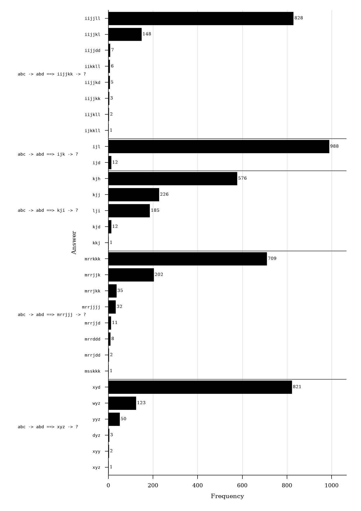
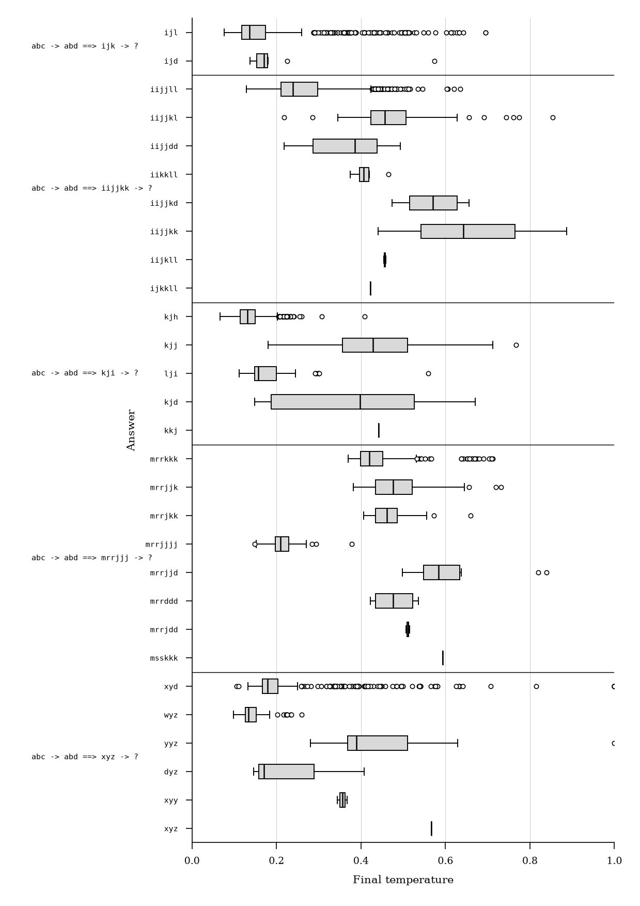
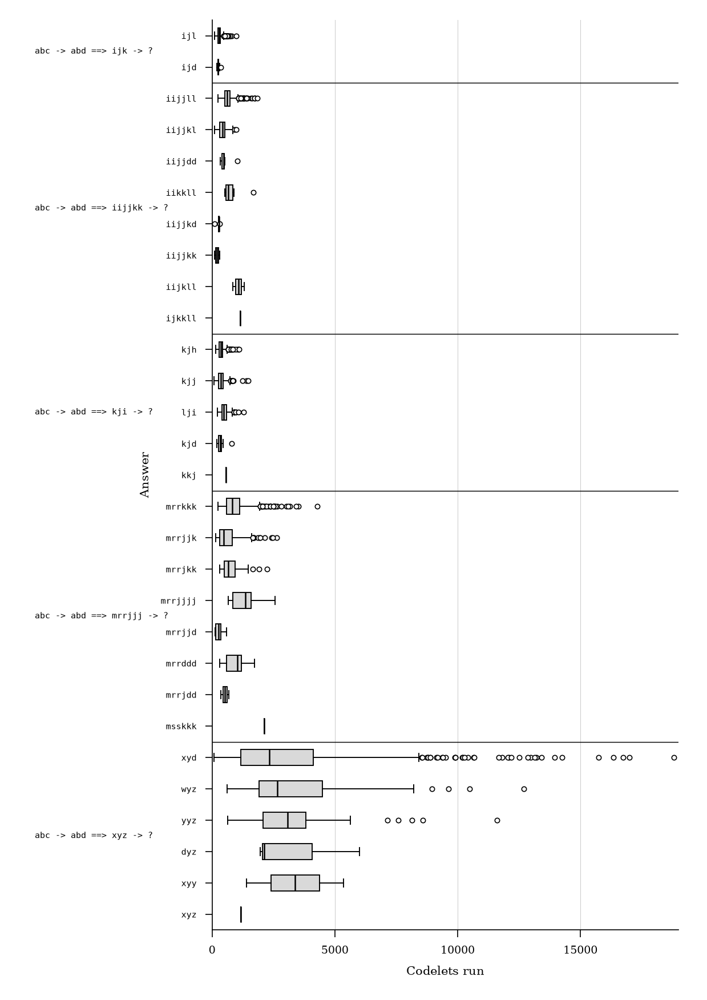
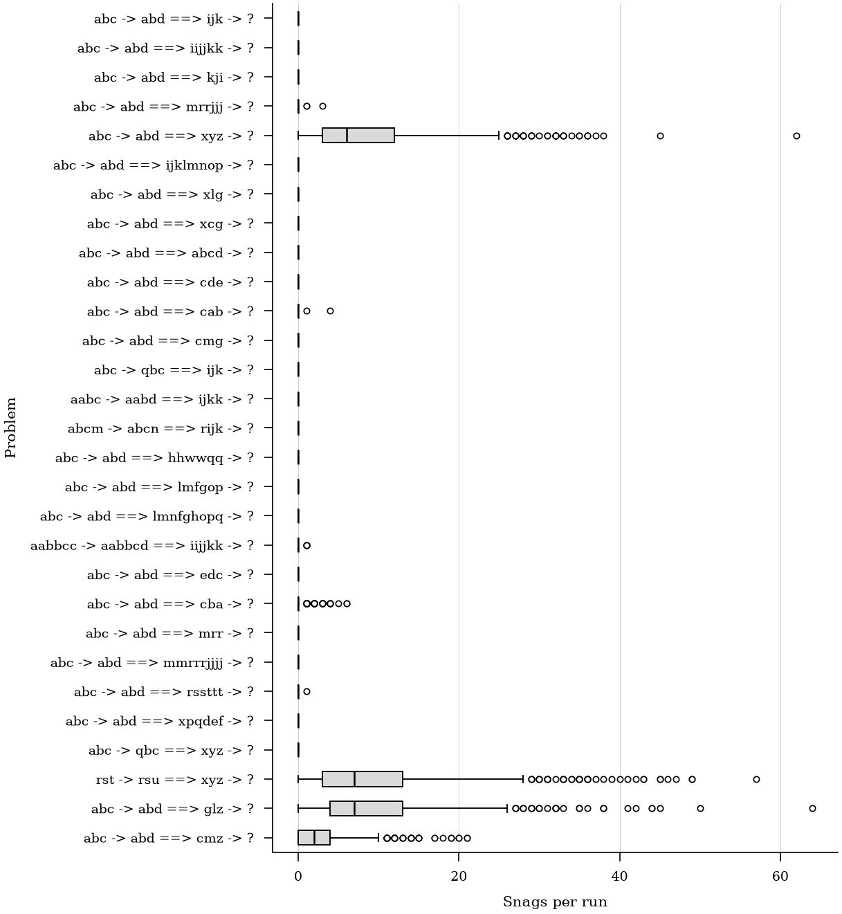
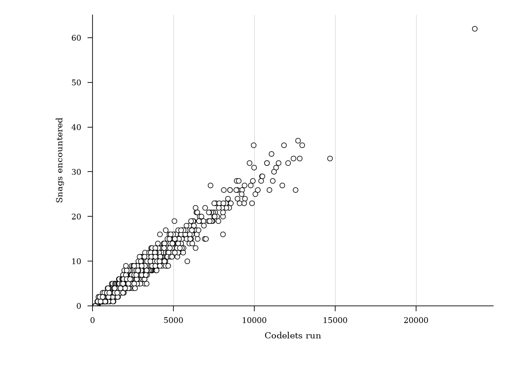

# Introduction

This paper describes a replication study of Copycat, a computer model of analogy-making that solves string analogies of the form "if _abc_ is transformed to _abd_, what is _ijk_ transformed to?" [@Mitchell1993].
The primary target for replication is the experimental evaluation reported in Chapters 4 and 5 of Mitchell [@Mitchell1993], comprising 1,000 runs on each of a fixed benchmark of five target problems and 24 variants problems.

Copycat is based on research by Douglas Hofstadter and the Fluid Analogies Research Group (FARG) into the flexible use of concepts by humans when they perceive and think about the world [@Hofstadter1995]. Copycat and related models represent an approach to artificial intelligence at the intersection of symbolic and statistical approaches and fit into a _middle-out_ approach to AI advocated for by Wang and Thórisson [@WangThorisson2025].

While the original implementation of Copycat is available online,[^original-copycat-download] it is written in a dialect of Common Lisp that is not compatible with the standard implementations available today and makes use of now non-existent dependencies. This makes the historically important result difficult to reproduce or build directly upon.

The Python re-implementation of Copycat described herein is the first step in a project that aims to construct a general library for building FARG-type models so that they can continue to be experimented on and better understood.
Copycat makes a good starting point for this research program as it is one of the best-documented models and it informed subsequent models produced by FARG and others.

Across the fixed 29-problem benchmark, the Python re-implementation produces answer frequencies and mean temperatures similar to those reported for the original Lisp Copycat.
This close re-implementation makes possible further analysis of the Copycat architecture, for example:
experiments to show how quantization of temperature and other values impacts on the efficiency of Copycat's search for solutions;
and a statistical and critical analysis of Copycat's encounters with and approach to handling _snags_ when solving certain problems.

# Background {#sec-background}

Copycat is a workspace-based architecture in which a problem is represented by graph-like data structures.
These are operated on by a series of micro-agents called _codelets_.
Codelets make incremental changes to the workspace such as by proposing, building, or destroying new connections, groupings, and rules that contribute towards a solution.
Once a codelet has run, it can spawn another follow-up codelet which is placed on a _coderack_ (a stochastic priority queue). The program also contains a symbolic network of spreading activation called a _slipnet_ whose nodes receive activation from the workspace and once fully active can post codelets to the coderack. Events such as codelet selection happen with a degree of randomness determined by the program's changing _temperature_, a measure of the quality of structures in the workspace. The program lacks a central orchestrator: choices are mostly made as a result of the interactions of many small components.

## FARG models and software

FARG models typically centre around a set of components similar to the workspace, slipnet, coderack, and temperature. Each model works in a particular micro-domain designed to test a particular type of perception or reasoning.

Copycat [@Mitchell1993] and Metacat [@Marshall1999] make analogies between transformations of letter strings;
Tabletop [@French1995] also makes analogies, but between objects pointed to on a table;
Capyblanca [@Linhares2014] makes analogies in chess;
Letter-spirit [@HofstadterMcGraw1995] completes the design of fonts once given some examples (a kind of visual analogy-making);
Jumbo [@Hofstadter1995jumbo] and Numbo [@Defays1995] build hierarchical structures of letters and numbers respectively in order to play an anagram or maths game;
Seqsee [@Mahabal2010] finds patterns in sequences of numbers in order to predict the next element;
Musicat [@Nichols2012] finds patterns in sequences of musical notes.

The original code for many (but not all) of these models is available online.[^fargonauts] The models were developed over an extended period of time using different programming languages, some of which are difficult to run on modern computers.

## The original Copycat

The original implementation of Copycat[^original-copycat-source] consists of nearly 12,000 lines of Common Lisp. It does not run unmodified in contemporary environments due to its dependence on obsolete software and dependencies.
The code includes the implementations of the various components described in @sec-background, written in a mixed object-oriented/procedural style. For the most part, it matches closely with the description of the model by Mitchell [@Mitchell1993].

But it also includes important functionality that Mitchell does not describe in detail, including: the steps involved in using a transformation rule to generate the answer string; how the program recognizes when a string cannot be built based on the rule (this is called hitting a _snag_); and how the program handles snags. Snag handling is discussed in more detail in @sec-snags.

The code contains various parameters that can be altered such as the frequency with which slipnet nodes' activations should be updated; weights used in functions for using temperature to alter probability distributions; the configuration of the slipnet with nodes representing concepts relevant to the domain (e.g. A, B, C, LETTER-CATEGORY, LEFT, LEFTMOST, OPPOSITE); and the weights of slipnet connections.

The original implementation's code is also interspersed with calls to a graphical user interface used to display the workspace structures and slipnet activations.

Readers should consult Mitchell [@Mitchell1993] or Hofstadter [@Hofstadter1995] for a full description of the architecture. Mitchell's book describing the architecture provides a large amount of implementation detail.

## Other implementations and generalizations

As one of the better known FARG models, Copycat has been re-implemented before with implementations made available online, including in Java[^java-copycat] and in Python[^python-copycat], but none of these appear to be accompanied by a full replication study including statistical comparison.

Metacat, which is an extension of Copycat implemented in Scheme,[^metacat] also has much in common with the original Copycat implementation.
Apart from Metacat, none of the re-implementations appear to have been made with a view to extending Copycat or to building a more general model.
Other projects exist online which have sought to build a more general FARG model, such as Paradex[^paradex] and PySeqsee,[^pyseqsee] but they no longer seem to be active.

# Methods

The benchmark comprises the five target problems and 24 variations reported by Mitchell [@Mitchell1993]. Published results were transcribed from chart labels in chapters 4 and 5 of Mitchell [@Mitchell1993]. These include: answer frequencies; mean final temperature per unique problem answer (with standard errors); and mean codelet counts per problem (with standard errors).

The experiments used the Python re-implementation of Copycat (version 0.1.1) available in the Cattykit repository (version 0.1.3) and were run with Python 3.13. Copycat was run 1,000 times on every problem, with the model instantiated anew using seeds 0--999; all runs continued until an answer was produced and no experimental runs were excluded.[^reproduction-artifacts]

There are three dimensions along which successful replication of the original study can be judged: similarity of answer distributions produced by reference and re-implementation; similarity of final temperatures for the same answers; and similarity of codelets run per problem.

Answer distributions are compared using total variation (TV) distance.
Each answer distribution is represented as a probability vector, with one component for each answer observed in either distribution.
TV distance is half the sum of the absolute differences between corresponding answer probabilities.
A distance of zero indicates identical distributions; values closer to 1 indicate greater discrepancy.
Subtracting the TV distance from one gives the empirical distributional overlap of the two implementations.

The TV distances can be compared to a 95% reference range of distances that would be expected from running the original Copycat experiments a second time and comparing their outputs with the reported results.
For each problem, the reference answer frequencies are treated as a fixed probability distribution and a simulated sample of 1,000 answers can be drawn from that distribution to produce a new set of answer frequencies.
The TV distance of sample and original reported distribution is calculated and a 95% reference range is built by taking the 2.5th and 97.5th percentiles from the distance calculations across 10,000 simulations.

Temperature error is calculated only for answers observed in both implementations and summarized both equally across answers and weighted by the published answer frequencies (to reduce the influence of outliers).
For a mean difference, the standardized discrepancy is calculated using the square root of the sum of the two squared standard errors; RMS z is the root mean square of these discrepancies across comparisons, excluding answers observed fewer than twice in either implementation, for which the standard error cannot be estimated.
For the purpose of this study, the original temperatures are converted to 2 decimal place floats between 0 and 1 so that they have the same representation as in the re-implementation.

Codelet count error is calculated per problem as the original study only reports mean codelet counts per problem.
The relative error is used for codelet counts as codelet counts have no upper bound (whereas temperature lies on a fixed scale).
It is calculated as the absolute difference between means divided by the published mean.

## Obstacles encountered

The re-implementation of the Copycat model was relatively free of obstacles as the original code is well-documented by both inline comments and the aforementioned publications. Furthermore it was possible during development to use LLM-based coding agents to perform code reviews by asking them to compare the two implementations. This sped up the search for discrepancies towards the end of development.

There were more obstacles when it came to a full replication of Mitchell's experiments on the model. Mitchell [@Mitchell1993] does not describe how 1,000 runs were performed, including whether or not random seeds were used, if so how they were chosen, and how the program was reset between runs (i.e. was it given a new seed or were components deleted or set back to their starting state?). The selection method of random seeds could affect the resulting distribution of behaviours.

Furthermore, Mitchell does not provide raw results of experiments: final temperatures and run lengths are reported as summary statistics (mean and standard error). This prevents a full comparison of final temperature and run length distributions. The statistics are also rounded to one decimal place, thus limiting the precision of cross-implementation comparison of the means and standard errors.

## Criteria for successful replication

Because Copycat is stochastic and because of the aforementioned obstacles, it is unreasonable to expect a re-implementation to perfectly replicate the results described by Mitchell and no hard pass/fail thresholds are used in this study.
But a successful replication ought to have a high overlap of answer distributions for each of the 29 problems with TV distance between re-implementation and reference answers also falling within the 95% reference range in most cases.
Mean absolute error of mean final temperature (weighted by answer frequency) should also be low. Higher errors for answers with low frequencies can be tolerated since the same answer can be output alongside a range of temperature values.
Mean relative error of mean codelets run should also be low, but similar run length is a less direct measure of behavioural agreement since it is path dependent and could be affected by the slight variations in answers and temperatures.

# The re-implementation of Copycat

The Python re-implementation was developed using the original Lisp source code and Mitchell's [@Mitchell1993] published descriptions as references. The main differences introduced in the re-implementation include:

* A bug fix relating to removal of excess codelets from the coderack. In Copycat, the coderack cannot contain more than 100 codelets. When codelets are added that would breach that maximum, older codelets should be removed probabilistically, weighted by their age and urgency. The original implementation removes codelets without removing their corresponding removal probability and codelets therefore lose alignment with their probability of being removed. In practice a sensitivity comparison shows that this makes little difference to overall behaviour, likely because relatively few codelets are removed at one time[^coderack-bug].
* Use of floating point numbers instead of integers between 0 and 100 for values such as temperature, slipnode activations, and workspace structure strengths. (In the evaluation described in @sec-evaluation, a quantization patch rounds numbers to two decimal places in order to more closely mirror the original Copycat source code's use of integers between 0 and 100. A further experiment in @sec-quantization explores the effect of removing this patch);
* Use of a matrix to define connections in the slipnet so that spreading activation could in future benefit from a parallelized GPU back-end.

# Evaluation {#sec-evaluation}

Statistics collected from runs of the re-implementation display close similarity to the statistics reported for the original Lisp implementation. Comparison statistics are summarized in @tbl-comparison-statistics. The re-implementation closely replicates answer distributions, temperatures (subject to limitations of historical summaries), and mean run lengths.

{#fig-target-problems-solution-frequency width=90%}

{#fig-target-problems-temperature-by-solution width=90%}

{#fig-target-problems-codelets-run-by-solution width=90%}

::: {#tbl-comparison-statistics}


Comparison statistics for the baseline replication across 29 problems.
:::

## Answer distributions

The re-implementation of Copycat outputs mostly the same answers with similar frequency to the original implementation.
The modal answer is identical for 28 of the 29 problems. For one problem, the two nearly tied most frequent answers are reversed[^different-mode].
All answers occurring in at least 1% of historical runs also occur in the replication study, and all answers occurring in at least 1% of replication runs are also reported in the historical study.

The average TV distance across all problems is 0.021, indicating a mean empirical overlap of 97.9%.
Overlap is (slightly) below 95% for just one of the 29 problems tested.
24 out of the 29 problems resulted in an answer distribution that has a TV distance within their 95% Monte Carlo reference range.
5 problems marginally exceeded their 95% reference range, but those ranges do not account for uncertainty in the published frequencies.
The re-implementation therefore closely replicates the published answer distributions.

## Final temperatures

Mean final temperatures for corresponding answers are also generally similar between reference and re-implementation.
Across the 29 problems, the mean absolute error is 0.005 when weighted by answer frequency and 0.037 when answers within each problem are given equal weight.
The higher unweighted error reflects, in part, larger discrepancies for many infrequent answers.
The largest difference is 46 percentage points for an answer observed only once in each implementation; such a mean is sensitive to the outcome of a single run.

Excluding answers observed only once in either implementation, for which a standard error cannot be estimated, the root mean square of the standardized discrepancy is 1.194.
The discrepancies are therefore, in aggregate, approximately the same order of magnitude as the combined reported sampling errors.

## Run lengths

Mean run lengths are similar between the two implementations across the benchmark. The mean relative error in codelets run is 3.3%. Agreement varied by problem: the largest relative error is 14.4%, but only one other problem has an error above 10%.

Run length is a less direct measure of behavioural agreement than the answers produced. It depends on the sequence of structures built and codelets selected during a run, so implementations may reach similar answers with different amounts of search. The root mean square of the standardized discrepancy of mean run length is 1.693, which indicates slightly greater discrepancies than can be expected from sampling along, but since this incorporates all 1,000 runs per problem, outliers are not excluded.

# Further analysis of the re-implementation

Having established that the Python re-implementation closely matches the original implementation of Copycat, it is possible to perform more novel analysis of Copycat. This section explores Copycat's snag handling procedure and the effect of replacing temperature, activations, and other values with full precision 64-bit floating point numbers.

## Snags {#sec-snags}

{#fig-all-problems-snag-count width=90%}

{#fig-problem-5-xyd-codelets-vs-snags width=60%}

Sometimes when solving a problem, Copycat can encounter a _snag_ (also referred to by Mitchell [@Mitchell1993] as an _impasse_). This happens when a rule is built that cannot be applied to the letters in the target string. For example, when producing a solution for the problem `abc -> abd ==> xyz`, Copycat might construct a rule to replace the letter `z` with its successor. But since `z` has no successor, Copycat cannot apply the rule.

In descriptions of the Copycat architecture, Mitchell [@Mitchell1993, p. 133] does not provide great detail of how snags are recognized and handled or how often they occur for each problem (other than that they occur on average 9 times per run for the `xyz` problem). The re-implementation allows further statistical analysis in this direction and shows (see @fig-all-problems-snag-count) no snags were encountered across 1,000 runs for most of the problems and that observed snags were concentrated in problems where solutions can relate to the ends of the alphabet or for groups with different numbers of letters.

Snag handling occurs during answer construction, which proceeds deterministically once a rule-translator codelet has built a rule for producing an answer. When a snag is hit, Copycat clamps its temperature to maximum, marks structures in the workspace as _snag structures_, deletes any proposed structures, deletes the translated rule, clamps the activation of descriptors of the object, and enters a _snag state_. It then periodically decides probabilistically (every 15 codelets) whether or not to leave a snag state according to the proportion of newly built structures that are equivalent to the structures present when the snag state was entered. Fewer equivalent structures increase the likelihood that the _snag state_ will be left and the program's temperature will be allowed to fall.

Handling snags allows Copycat to continue trying to find a solution. As noted by Mitchell [@Mitchell1993, p. 133], this can often result in the same problematic structures being retried, something which humans can also be prone to when they try to solve hard problems. This can be seen in @fig-target-problems-codelets-run-by-solution, where the relatively mundane answer to `abc -> abd ==> xyz -> xyd` has a very wide distribution of run lengths. This is largely associated with repeated snags occurring when the program tries to find the successor to `z`. @fig-problem-5-xyd-codelets-vs-snags shows a strong positive association between snags encountered and codelets run for the 835 runs producing this answer (Pearson's *r* = 0.980, 95% CI [0.977, 0.982]). Across the 9 recorded problems which encountered snags, linear regression estimates an association of between 349 and 1,341 additional codelets per additional snag. This association is partly mechanical: a snag forces more codelets to run so that it can be fixed and more codelets running on a hard problem increases opportunities for snags.

Snag handling is deterministic, requires a more global view of the workspace, and is tailored to a specific subset of Copycat's problems. This deviates from the broader style of the architecture in which responsibility for observing and editing the workspace is usually delegated to codelets stochastically selected from the coderack. It might therefore be judged to be incompatible with the broader FARG approach to AI and it has indeed been further addressed in the model Metacat, an extension of Copycat which Marshall [@Marshall1999] describes as having _self-watching_ capabilities. This will be the subject of a future replication study.

## Comparison of numeric quantization methods {#sec-quantization}

::: {#tbl-quantization-comparison}


Comparison of two decimal place quantization and full precision variants across 29 problems.
:::

As described above, this re-implementation of Copycat makes use of floating point numbers for values such as slipnode activation, but in the above experiments, a patch was used which rounded floating point numbers to two decimal places so as to better match the original Copycat implementation.
Removal of the patch so that floating point numbers use 64-bit precision results in similar answer distributions and temperatures for each answer. But it results on average in much longer run lengths.

@tbl-quantization-comparison shows that both variants have high agreement with the published answer frequencies and temperature means. Their answer distributions have the same TV distance from the reported results and their average temperature errors are very low. Only a slight increase in the overall discrepancy in temperature scores is observed for the 64-bit version.

The main difference between the two is evident in search effort (measured in codelets executed).
The quantization patch is implemented with a rounding step whenever any floating point number is assigned to an object's attribute (e.g. the temperature, slipnode activations, and workspace structure strength values). It also rounds NumPy state, probability calculations, temperature-adjusted values, and weighted-selection weights.
There can therefore be no advantage to quantization in terms of memory usage (the same underlying data type is used) or to wall-clock run-time per codelet (the rounding steps add extra operations).
But removing the two decimal place quantization patch more than doubles the mean relative error against the published codelet counts and increases the maximum relative error from 14.4% to 41.8%.
Using higher precision for temperature, activations, strength values, and other numbers therefore has little effect on answers and temperatures but substantially increases the effort required to find answers.
The aggregate snag rate is nearly unchanged.
Each program version observes at least one snag in a set of 9 different problems, the union of which contains 10 unique problems.
Across these, six have lower mean snag counts with the quantization patch, while four have higher counts. The increase in codelet counts is therefore not explained by an increase in snags.

Rounding values in the program introduces slight changes at which values cross certain thresholds.
Many of these values are used to calculate codelet urgencies which determine the urgency bin that each codelet is placed in.
Successive rounding up and down might be increasing the separation between beneficial and harmful structures, slipnodes, and codelets and therefore reducing time spent exploring pathways that do not lead to a solution.

# Conclusion

This paper introduces a Python re-implementation of the analogy-making model Copycat.
On the 29-problem benchmark, the Python re-implementation closely reproduces the published answer frequencies and generally reproduces the reported conditional temperature means and mean run lengths.
This replication study has allowed for further analysis of how Copycat encounters and handles _snags_, and of the relationship between numeric quantization and search effort.

## Limitations

The statistical comparisons show close behavioural agreement on the 29-problem benchmark, but do not establish that the two implementations are logically equivalent. The original study does not report its random seeds, so the comparison concerns distributions and summary statistics rather than matching individual runs.

The published answer frequencies permit a direct comparison of empirical answer distributions. However, the original raw run-level temperature and codelet count data are unavailable, so those comparisons are restricted to the reported means and standard errors. Rounding of the published statistics also limits the precision of the comparisons, particularly for infrequent answers.

## Future Work

This Copycat replication study is situated in a broader program of research aimed towards a more generalized library - Cattykit - for use in the development of FARG-style models of artificial intelligence which could in future be used as part of experimental neuro-symbolic architectures described by Wright [@Wright2026]. The most likely next steps in this program will be: a replication study of Metacat, an architecture which extends Copycat with so-called _self-watching_ capabilities; and the abstraction of common components from Copycat and Metacat into a shared library. Concurrent with the development of the Cattykit library, will be the development of Cattycam, a tool for observing the inner workings of Cattykit models.

# References

[^original-copycat-download]: <https://melaniemitchell.me/ExplorationsContent/how-to-get-copycat.html>
[^fargonauts]: <https://github.com/fargonauts>
[^original-copycat-source]: <https://melaniemitchell.me/ExplorationsContent/how-to-get-copycat.html>
[^java-copycat]: <https://archive.org/details/JavaCopycat>
[^python-copycat]: <https://github.com/LSaldyt/copycat>
[^metacat]: <https://science.slc.edu/~jmarshall/metacat/>
[^paradex]: <https://github.com/fargonauts/paradex>
[^pyseqsee]: <https://github.com/amahabal/PySeqsee>
[^cattykit]: <https://github.com/georgeawright/cattykit>
[^copycat-source]: <https://github.com/georgeawright/cattykit/tree/main/models/copycat>
[^reproduction-artifacts]: The experiment scripts, locked software environment, raw results, and generated summaries are provided at <https://github.com/georgeawright/cattykit/tree/copycat-reproduction-v0.1.1/experiments/copycat-reproduction> and <https://github.com/georgeawright/cattykit/tree/copycat-reproduction-v0.1.1/datasets/copycat-reproduction>.
[^coderack-bug]: A full comparison of behaviour with the fixed vs faithful coderack removal method can be found here: <https://github.com/georgeawright/cattykit/blob/main/papers/copycat-reproduction/tables/coderack-removal-method-comparison.md>.
[^different-mode]: For problem _abcm -> abcn ==> rijk_, the re-implementation's most frequent answer, _rijl_ (frequency=420) is the second most frequent answer for the original (frequency=391). The original's most frequent answer, _sijk_ (frequency=398) is the second most frequent answer for the re-implementation (frequency=418).
