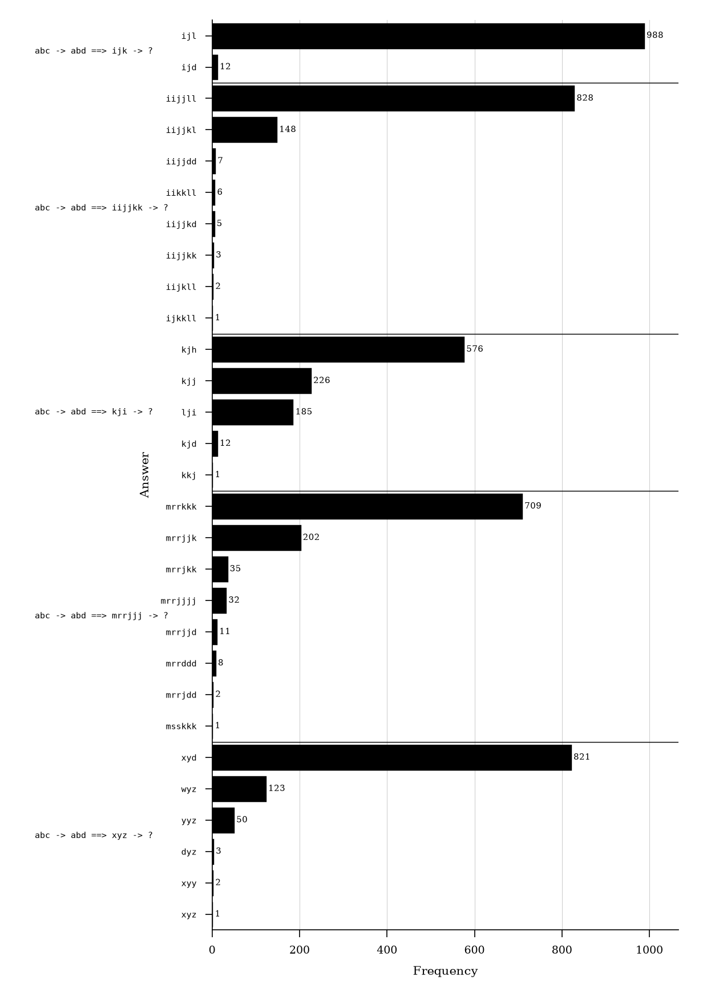
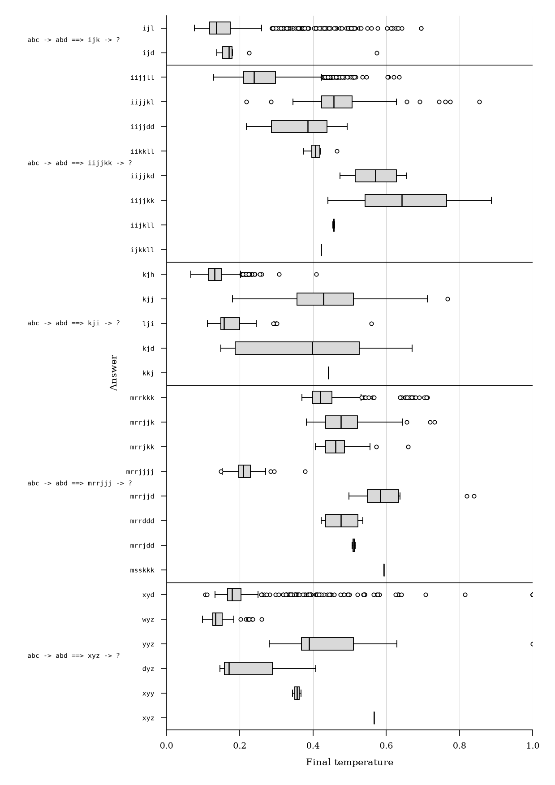
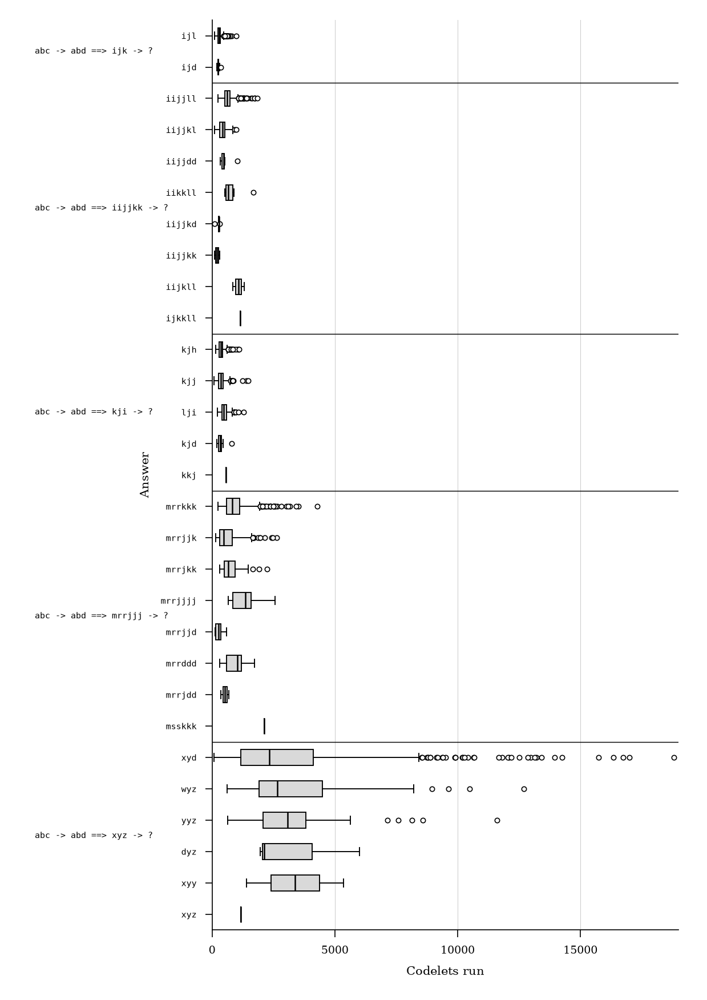
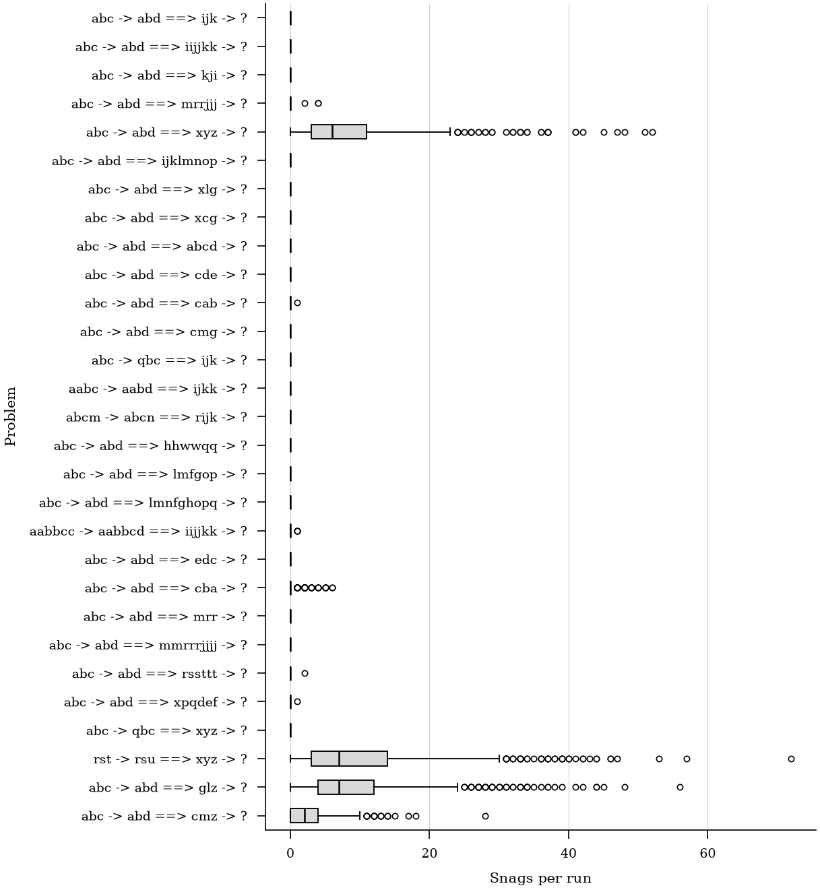
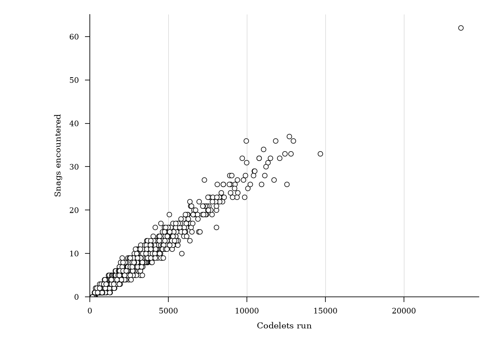

# Introduction

This paper describes a reproduction study of Copycat, a computer model of analogy-making that solves string analogies of the form "if _abc_ is transformed to _abd_, what is _ijk_ transformed to?" [@Mitchell1993].
Copycat is based on research by Douglas Hofstadter and the Fluid Analogies Research Group (FARG) into the flexible use of concepts by humans when they perceive and think about the world [@Hofstadter1995].
While the original implementation of Copycat is available online,[^original-copycat-download] it is written in a dialect of Lisp that is not compatible with the standard implementations available today and makes use of now non-existent dependencies.

The Python re-implementation of Copycat described herein is the first step in a project that aims to construct a general library for building FARG-type models so that they can continue to be experimented on and better understood.
Copycat makes a good starting point for this research program as it is one of the best-documented models and it informed subsequent models produced by FARG and others.

Across the fixed 29-problem benchmark, the Python re-implementation produces answer frequencies and mean temperatures similar to those reported for the original Lisp Copycat.
This close re-implementation makes possible further analysis of the Copycat architecture, for example:
a statistical and critical analysis of Copycat's encounters with and approach to handling _snags_ when solving certain problems;
and experiments to show how quantization of temperature and other values impacts on the efficiency of Copycat's search for solutions.

# Background

Copycat is a workspace-based architecture in which a problem is represented by graph-like data structures.
These are operated on by a series of micro-agents called _codelets_.
Codelets make incremental changes to the workspace such as by proposing, building, or destroying new connections, groupings, and rules that contribute towards a solution.
Once a codelet has run, it can spawn another follow-up codelet which is placed on a _coderack_ (a stochastic priority queue). The program also contains a symbolic network of spreading activation called a _slipnet_ whose nodes receive activation from the workspace and once fully active can post codelets to the coderack. Events such as codelet selection happen with a degree of randomness determined by the program's changing _temperature_, a measure of the quality of structures in the workspace. The program lacks a central orchestrator and choices are mostly made as a result of the interactions of many small components.

Copycat was originally motivated by Hofstadter's desire for more cognitively plausible Artificial Intelligence models that focus on the flexible way that concepts form and change as people think. Hofstadter and Mitchell describe Copycat and related architectures as models of _high level perception_ and place them in between the levels modeled by _bottom-up_ neural/connectionist and _top-down_ logic-based approaches to AI which had become two sides in a long-standing debate in both AI and Cognitive Science research. It fits instead into a _middle-out_ approach to AI for which Wang and Thórisson [@WangThorisson2025] advocate.

Copycat and similar computer models produced by the Fluid Analogies Research Group appeared on the scene at a time when expert systems based on logic and rules were increasingly seen to have failed as an approach to AI and when neural networks were first producing successful results (but before they were as successful and as widely adopted as they are today).

Being both conceptually and chronologically sandwiched between these two large competing camps is perhaps one reason why the Copycat architecture and its underpinning ideas were not more widely adopted in AI research. Other substantial problems include the practical difficulty in building a program like Copycat. As described above, it is a complex system with many interacting components and is thus difficult to debug. Furthermore, the models of the Fluid Analogies Research Group were focused on _micro-domains_ (also disparagingly known as _toy problems_) and while they may make convincing abstract theoretical models of important cognitive processes such as analogy-making and pattern recognition, the challenge of applying these approaches in practical domains is significant.

Despite this, Copycat can be seen to prefigure some important trends in contemporary AI and its increasing orientation towards a synthesis of neural and symbolic methods:

- *In-context learning* Hofstadter initially described Jumbo (a precursor to Copycat developed in the 1980s) as a model of machine learning, but this work was excluded from early machine learning research p.95 [@Hofstadter1995]. _Machine learning_ has typically referred to the use of statistical techniques to induce functions to predict correct labels or regressions from datasets. More recently, with the discovery that large language models can learn new tasks at inference time, there is increasing interest in in-context or few-shot machine learning, whereby examples given in a prompt can be used to teach a model a skill that was not present in its original training data. Copycat is in essence a _one-shot_ learner: it is given one example string transformation, uses it to form an abstract rule for string transformations, and applies that rule to a new string. It therefore fits more neatly with modern machine learning research into how models are conditioned by their inputs.

- *Tool use* Beyond natural language processing, LLMs are now typically used within so-called _agentic_ systems which give the model access to external tools such as web search, calculators, program interpreters, or other more specialized neural networks. This allows them to augment their context beyond the initial prompt using information that could not be reliably produced from decoding the model (e.g. with facts that post-date the model's training data or with the results of novel calculations). In such a system the tools and context play a similar role to the codelets and workspace found in Copycat, but a computationally expensive (and therefore energy-intensive) LLM is also required to plan, orchestrate, and collate tool outputs into an answer. In the Copycat architecture, responsibility for co-ordination is distributed between codelets and slipnet nodes with only lightweight mediation by the coderack's scheduling.

An agentic system with Copycat-like distributed orchestration between perhaps smaller language models or other neural networks might have the potential to reduce expensive LLM calls while also expanding the flexible behaviour of Copycat beyond its micro-domain [@Wright2026]. This warrants further research into the Copycat architecture so that it can be further experimented on and better understood. But such research is hampered by the lack of a Copycat implementation that can be run in modern programming environments. This was the motivation for the reproduction study described in this paper.

## FARG models and software

FARG models typically centre around a set of components similar to those that make up Copycat, including a workspace where structures are built, a Slipnet which keeps track of relevant concepts, a coderack which schedules codelets, and a temperature score which measures the quality of the workspace and controls the degree of randomness in the program. Across models, implementations of these components vary and they are sometimes referred to with different names. Some models have other extra components.

Each model works in a particular micro-domain designed to test a particular type of perception or reasoning:
Copycat [@Mitchell1993] and Metacat [@Marshall1999] make analogies between transformations of letter strings;
Tabletop [@French1995] also makes analogies, but between objects pointed to on a table;
Capyblanca [@Linhares2014] makes analogies in chess;
Letter-spirit [@HofstadterMcGraw1995] completes the design of fonts once given some examples (a kind of visual analogy-making);
Jumbo [@Hofstadter1995jumbo] and Numbo [@Defays1995] build hierarchical structures of letters and numbers respectively in order to play an anagram or maths game;
Seqsee [@Mahabal2010] finds patterns in sequences of numbers in order to predict the next element;
Musicat [@Nichols2012] finds patterns in sequences of musical notes.

The original code for many (but not all) of these models is available online.[^fargonauts] The models were developed over an extended period of time using different programming languages, many of which are no longer supported on modern computers.

## The original Copycat

The original implementation of Copycat[^original-copycat-source] consists of nearly 12,000 lines of Common Lisp, but which will not run with modern Lisp interpreters as it relies on outdated dependencies.

The code includes the implementations of the various components described above as well as the method for building answers and handling snags described below.
Code is interspersed with calls to a graphical user interface used to display the workspace structures and slipnet activations and is written in a mixed object-oriented/procedural style.

It also contains various parameters that can be altered such as the frequency with which slipnet nodes' activations should be updated; weights used in functions for using temperature to alter probability distributions; and the configuration of the slipnet with nodes representing concepts relevant to the domain (e.g. A, B, C, LETTER-CATEGORY, LEFT, LEFTMOST, OPPOSITE) and the weights of their connections.

Readers should consult Mitchell [@Mitchell1993] or Hofstadter [@Hofstadter1995] for a full description of the architecture. Mitchell's book describing the architecture provides a large amount of implementation detail.

## Other implementations and generalizations

As one of the better known FARG models, Copycat has been reproduced before with implementations made available online, including in Java[^java-copycat] and in Python.[^python-copycat]
Metacat, which is an extension of Copycat implemented in Scheme,[^metacat] also has a lot in common with the original Copycat implementation.

Apart from Metacat, none of these projects appear to have been made with a view to extending Copycat or to building a more general model.
Other projects exist online which have sought to build a more general FARG model, such as Paradex[^paradex] and PySeqsee,[^pyseqsee] but they no longer seem to be active.

# Methods

The benchmark comprises the five target problems and 24 variations reported by Mitchell [@Mitchell1993]. Published answer frequencies, answer-conditional final-temperature means and standard errors, and problem-level codelet-count means and standard errors were transcribed from the source. The problems are treated as a fixed benchmark, not as a random sample from a wider population of analogy problems.

The experiments used Python 3.13, Copycat 0.1.0, and Cattykit 0.1.2. Each implementation was run 1,000 times on every problem, with the model instantiated anew using seeds 0--999; all runs continued until an answer was produced and no experimental runs were excluded. The same seed set was used for the full-precision baseline, the two-decimal quantization variant, and the faithful-original coderack-removal variant. The quantization and coderack patches are described in their respective sections below.

Answer distributions were compared using total variation (TV) distance, with empirical overlap defined as one minus TV distance. Temperature error was calculated only for answers observed in both implementations and summarized both equally across answers and weighted by the published answer frequencies; unmatched answer categories were counted separately. For a mean difference, the standardized discrepancy was calculated using the square root of the sum of the two squared standard errors; RMS z is the root mean square of these discrepancies across comparisons. Codelet-count error is the absolute difference between means divided by the published mean. Monte Carlo analyses used 10,000 samples with seed 0.[^reproduction-artifacts]

# The re-implementation of Copycat

The Python re-implementation described in this paper has been designed for the future purpose of building a generalized library out of the components of FARG models called Cattykit.[^cattykit] Eventually it is planned that Cattykit will contain the components needed to recreate previously built models for the purpose of experimentation; to develop novel models with a similar structure; and to integrate these models within a neuro-symbolic architecture as described by Wright [@Wright2026].

The current state of the Copycat re-implementation[^copycat-source] is still a self-contained model, but it has been written in a style that will facilitate this future abstraction: components are object-oriented; and parameters are largely kept out of the code and placed in configuration files, especially the nodes and link weights of the Slipnet.

The main differences introduced in this re-implementation include:

* The use of floating point numbers instead of integers between 0 and 100 for values such as temperature, slipnode activations, and workspace structure strengths. The effect of this is discussed below;
* A fix to a bug found in the removal of codelets from the coderack;
* Use of a matrix to define connections in the slipnet so that spreading activation could in future benefit from a parallelized GPU back-end.

# Evaluation

Mitchell [@Mitchell1993] reports the results from running Copycat 1,000 times each on 29 problems (5 target problems and 24 variations), recording: the answers given and their frequency; the mean final temperature (with standard error) for each answer; and the mean number of codelets run when solving each problem (also with standard error).

Fidelity of the Python re-implementation was assessed by comparing its answers, mean temperatures, and mean run lengths with the published summaries for the same problems. @fig-target-problems-solution-frequency shows the distribution of answers given by the re-implementation for each of the five target problems; @fig-target-problems-temperature-by-solution shows the distribution of final temperatures for each answer; @fig-target-problems-codelets-run-by-solution shows the distribution of codelets run for each answer.

As discussed in the following sections, statistics collected from runs of the re-implementation display close similarity to the statistics reported for the original Lisp implementation.

{#fig-target-problems-solution-frequency width=90%}

{#fig-target-problems-temperature-by-solution width=90%}

{#fig-target-problems-codelets-run-by-solution width=90%}

## Comparison statistics



## Answer distributions

The re-implementation of Copycat outputs similar answers with similar frequency to the original implementation.
The modal answer is identical for all 29 problems.
Most answers occurring in at least 1% of historical runs also occur in the reproduction, with one exception.
The reproduction on average generates between one and two new answers not reported in the original results but only once generates a previously unreported answer at a frequency above 1%.

@tbl-comparison-statistics quantifies the similarity of answer distribution between the two distributions with total variation distance (TV distance).
Each answer distribution is represented as a probability vector, with one component for each answer observed in either distribution.
TV distance is half the sum of the absolute differences between corresponding answer probabilities.
A distance of zero indicates identical distributions; values closer to 1 indicate greater discrepancy.
Subtracting the TV distance from one gives an estimate of the probability mass overlap between the two implementations.
The average TV distance across all problems is 0.022, indicating a mean empirical overlap of 97.8%.
Overlap is (slightly) below 95% for just two of the 29 problems tested.

22 out of the 29 problems resulted in an answer distribution that has a TV distance within the 95% Monte Carlo reference ranges found with 1,000 run samples from the original implementation's reported answer distributions.
7 problems marginally exceeded their 95% Monte Carlo reference ranges.
The re-implementation therefore closely reproduces the published answer distributions in absolute terms, but its TV distances are slightly larger than expected from finite-sample variation under a plug-in model treating published frequencies as fixed.

## Final temperatures

As well as producing an answer, Copycat also provides a final temperature score, which summarizes the strength and connectedness of structures in the workspace and can act as an approximate measure of answer quality.
Because answers can be generated as a result of different underlying structures or with other structures present that do not contribute to an answer, the same answer generated many times can be accompanied by a range of final temperatures (@fig-target-problems-temperature-by-solution shows the distribution of temperatures for answers to each of the five target problems).
Over one thousand runs, an accurate reproduction of Copycat should not only produce a similar distribution of answers, but also similar mean temperature scores for each answer.
The full temperature distributions for the original implementation are not available, so comparisons are limited to its reported means and standard errors.

In most cases, the final temperatures output by the reproduction are indeed similar to those of the original implementation.
The difference between reproduction and reference temperature for each problem's solution (the absolute error between the means) is usually close to zero and the size of the difference is usually acceptable considering the variance recorded in reference results.

@tbl-comparison-statistics reports the mean and maximum of absolute error for the temperatures associated with the answers of each problem, both unweighted (giving equal emphasis to the mean temperature scores of each answer regardless of output frequency), and weighted by answer frequency.
Mean temperatures are rarely more than one percentage point away from those of the original implementation, though in the worst case (with infrequent answers) the temperature can be 26 percentage points away.
The unweighted mean absolute error across all 29 problems is 0.027, but the answer frequency weighted mean is 0.005.
The root mean square of the standardized temperature-mean discrepancies is 1.583. This summarizes mean-level disagreement relative to the reported sampling errors; it does not establish that the underlying temperature distributions have the same shape.

## Run lengths

For each problem, Mitchell [@Mitchell1993] also reports the mean codelets run (and standard error) when Copycat is given that input. It is therefore possible to check if effort (in terms of codelets run) is comparable between the two implementations.

The re-implementation has a similar mean number of codelets run to the original for many problems, though the difference is more noticeable than for answers and temperatures. Relative error is used because run lengths vary substantially in scale between problems, whereas temperature is always on the fixed scale between 0 and 1.

The high root mean square of the standardized mean differences for codelets run of nearly 4 indicates that the re-implementation is less aligned with the original in terms of run length than might be desired.
The mean relative error in codelets run (7.1%) is higher than the mean absolute error for temperature. It also varies by problem: the maximum is 41.8% and 8 out of the 29 problems had errors above 10%.
Some variation in the number of codelets run is tolerable as the quantity and exact identity of codelets run is path dependent and can vary substantially depending on the structures built and the changing temperature during the run.
As discussed below, a variant using two-decimal quantization produces mean run lengths closer to the published results, suggesting that numerical precision contributes to some of the disagreement.

## Snags

{#fig-all-problems-snag-count width=90%}

Sometimes when solving a problem, Copycat can encounter a _snag_ (also referred to by Mitchell [@Mitchell1993] as an _impasse_). This happens when a rule is built that cannot be applied to the letters in the target string. For example, when producing a solution for the problem `abc -> abd ==> xyz`, Copycat might construct a rule to replace the letter `z` with its successor. Since `z` has no successor, Copycat cannot apply the rule.

In descriptions of the Copycat architecture, Mitchell [@Mitchell1993] does not provide great detail of how snags are recognized and handled or how often they occur for each problem (other than that they occur on average 9 times per run for the `xyz` problem, page 133). The re-implementation allows further statistical analysis in this direction and shows (see @fig-all-problems-snag-count) no snags were encountered across 1,000 runs for most of problems and that observed snags were concentrated in problems where solutions can relate to the ends of the alphabet or for groups with different numbers of letters.

Snag handling runs as part of answer construction which runs deterministically once a rule translator codelet has built a rule for producing an answer. When a snag is hit, Copycat clamps its temperature to maximum, marks structures in the workspace as _snag structures_, deletes any proposed structures, deletes the translated rule, clamps the activation of descriptors of the object, and enters a _snag state_. It then periodically decides probabilistically (every 15 codelets) whether or not to leave a snag state according to the proportion of newly built structures that are equivalent to the structures present when the snag state was entered. Fewer equivalent structures increase the likelihood that the _snag state_ will be left and the program's temperature will be allowed to fall.

Handling snags allows Copycat to continue trying to find a solution. As noted by Mitchell [@Mitchell1993, p. 133], this can often result in the same problematic structures being retried, something which humans can also be prone to when they try to solve hard problems. This can be seen in @fig-target-problems-codelets-run-by-solution, where the relatively mundane answer to `abc -> abd ==> xyz -> xyd` has a very wide distribution of run lengths. This is largely associated with repeated snags occurring when the program tries to find the successor to `z`. @fig-problem-5-xyd-codelets-vs-snags shows a strong positive association between snags encountered and codelets run for the 821 runs producing this answer (Pearson's *r* = 0.981, 95% CI [0.978, 0.984]). Across the 10 recorded problems which encountered snags, linear regression estimates an association of between 342 and 2,962 additional codelets per additional snag. This association is partly mechanical: a snag requires more codelets to be run to fix it and more codelets running creates more opportunities for snags. It should therefore not be interpreted as an unqualified causal effect.

Snag handling is deterministic, requires a more global view of the workspace, and is tailored to a specific subset of Copycat's problems. This deviates from the broader style of the architecture in which responsibility for observing and editing the workspace is usually delegated to codelets stochastically selected from the coderack. It might therefore be judged to be incompatible with the broader FARG approach to AI and it has indeed been further addressed in the model Metacat, an extension of Copycat which Marshall [@Marshall1999] describes as having _self-watching_ capabilities. This will be the subject of a future reproduction study.

{#fig-problem-5-xyd-codelets-vs-snags width=90%}

## Comparison of numeric quantization methods



As described above, this re-implementation of Copycat makes use of floating point numbers for values such as slipnode activation.
This was motivated by the use of floating point to allow for richer representations in the activations and weights in neural networks, and the hope that future iterations of this architecture could be integrated with neural representations.
Comparing the re-implementation with a patched version that rounds floating point numbers to two decimal places shows that both variants have similar agreement with the published answers and temperature means, while the quantized variant agrees more closely with the published mean run lengths.

@tbl-quantization-comparison shows that the two variants have similar levels of agreement with the published answer frequencies and temperature means.
The quantized version's answer distributions are slightly closer to the published results (with 23 out of the 29 problems within the 95% Monte Carlo reference range), while the full-precision version has slightly smaller temperature-error measures.

The main difference between the two is evident in search effort (measured in codelets executed).
In this experiment, quantization is implemented by a program patch that adds a rounding step whenever any floating point number is assigned to an object's attribute (e.g. the temperature, slipnode activations, and workspace structure strength values). It also rounds NumPy state, probability calculations, temperature-adjusted values, and weighted-selection weights.
There can therefore be no advantage to quantization in terms of memory usage (the same underlying data type is used) or to wall-clock run-time per codelet (the rounding steps add extra operations).
Using two-decimal-place quantization more than halves the mean relative error against the published codelet counts and reduces the maximum relative error from 41.8% to 14%.
This brings mean run lengths more in line with those reported for the original implementation. The aggregate snag rate is nearly unchanged: six of the ten baseline problems in which snags were observed have lower mean counts under quantization, while four have higher counts.

Rounding values in the program introduces slight changes at which values cross certain thresholds.
Many of these values are used to calculate codelet urgencies which determine the urgency bin that each codelet is placed in.
Successive rounding up and down may have increased separation between beneficial and harmful structures, slipnodes, and codelets and reduced time spent exploring pathways that do not lead to a solution.

## Comparison of coderack removal methods



One change to the program introduced in the re-implementation is the method for removing codelets from the coderack. In Copycat, the coderack cannot contain more than 100 codelets, so when codelets are added that would breach that maximum, older codelets need to be removed probabilistically, weighted by their age and urgency. A slight bug in the original implementation removes codelets without removing their corresponding removal probability weight and codelets therefore lose alignment with their probability of being removed.

As shown by @tbl-coderack-removal-comparison, the fixed and faithful-original variants have similar levels of agreement with the published answer frequencies, temperature means, and mean run lengths. This comparison is relative to the historical summaries and does not directly estimate a paired effect of the bug fix.

# Conclusion

This paper introduces a Python re-implementation of the analogy-making model Copycat.
On the fixed 29-problem benchmark, the Python re-implementation closely reproduces the published answer frequencies and generally reproduces the reported conditional temperature means. Agreement in mean run length is weaker, but two-decimal quantization increases alignment in this dimension.
The re-implementation has allowed for further analysis of how the model encounters and handles _snags_, and of the relationship between numeric quantization and search effort.
This paper also describes a minor bug fix.

## Limitations

This paper has generally avoided discussion of statistical significance.
With 1,000 runs per problem, even small discrepancies may be estimated precisely.
Evaluation therefore assesses reproduction primarily through effect sizes, rather than treating a non-significant difference as evidence of equivalence.

## Future Work

This Copycat re-implementation is situated within a broader program of research and software engineering that aims to build a more generalized library - Cattykit - for use in the development of FARG-style models of Artificial Intelligence which could in future be used as part of experimental neuro-symbolic architectures. The most likely next steps in this program will be: a reproduction study of Metacat, an architecture which extends Copycat with so-called _self-watching_ capabilities; and the abstraction of common components from Copycat and Metacat into a shared library. Concurrent with the development of the Cattykit library, will be the development of Cattycam, a tool for observing the inner workings of Cattykit models.

# References

[^original-copycat-download]: <https://melaniemitchell.me/ExplorationsContent/how-to-get-copycat.html>
[^fargonauts]: <https://github.com/fargonauts>
[^original-copycat-source]: <https://melaniemitchell.me/ExplorationsContent/how-to-get-copycat.html>
[^java-copycat]: <https://archive.org/details/JavaCopycat>
[^python-copycat]: <https://github.com/LSaldyt/copycat>
[^metacat]: <https://science.slc.edu/~jmarshall/metacat/>
[^paradex]: <https://github.com/fargonauts/paradex>
[^pyseqsee]: <https://github.com/amahabal/PySeqsee>
[^cattykit]: <https://github.com/georgeawright/cattykit>
[^copycat-source]: <https://github.com/georgeawright/cattykit/tree/main/models/copycat>
[^reproduction-artifacts]: The experiment scripts, locked software environment, raw results, and generated summaries are provided at <https://github.com/georgeawright/cattykit/tree/main/experiments/copycat-reproduction> and <https://github.com/georgeawright/cattykit/tree/main/datasets/copycat-reproduction>.
